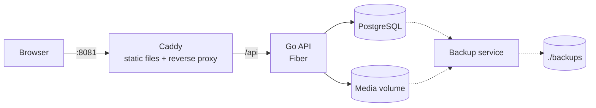

# Onyx
[](https://github.com/fersuarezz/Onyx/actions/workflows/cicd.yml)

A personal app suite made in Go. Currently it is just a diary app. Applying good design principles with a professional deployment.

## Features
- Media and text upload
- Date navigation
- Global search
- CI/CD
- Integration tests
- Automatic local backups
- Automatic migrations

## Roadmap
- Unit tests
- Redis cache
- DB indexing
- Better healthcheck
- User auth


## Stack
- Backend: Go, PostgreSQL
- DevOps: GitHub Actions, GHCR, Docker, Tailscale
- Frontend: JS, HTML, CSS, Caddy

## Quick start
You need Docker installed. To download and execute the app for the first time:

Run:
```bash
git clone https://github.com/fersuarezz/Onyx.git Onyx
cd Onyx
docker compose up
```

Open http://127.0.0.1:8081  
 

## Architecture



- **Caddy** serves the frontend and proxies `/api` to the backend. Only Caddy is exposed. 
- **Backups** run every Sunday at 3:00: a `pg_dump` and the media volume are stored in `./backups`.
- **Migrations** are applied automatically when the API starts.

### Backend
Layered design with dependencies pointing inwards:

```
backend/
├── controller/   HTTP layer: routes, handlers and DTOs
├── service/      Business logic, defines the interfaces it needs
├── repository/   Implementations
│   ├── postgres/   Data access with pgx
│   └── storage/    Filesystem storage
├── domain/       Shared types and errors
├── migrations/   Versioned SQL migrations
└── composition.go  Dependency injection
```


### Testing and CI/CD
- Repository tests run against a real PostgreSQL instance created with Testcontainers.
- GitHub Actions runs on push and PR: `go mod tidy` check, `go vet`, build, tests, `gofmt` check and a Docker image build.
- The Docker image is uploaded to GHCR and pulled by the server, checking the commit SHA


## Disclaimer
The frontend was entirely developed using AI. It's a personal project and my passion is backend and dev-ops.
